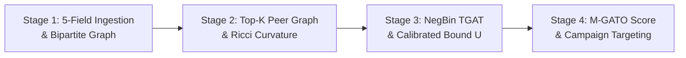

# HAMTA: Hierarchical Attentive Merchant Topology Analytics

[](https://www.python.org/downloads/)
[](https://opensource.org/licenses/MIT)
[](https://icae.sbu.ac.ir/)
[]()

Official open-source research implementation of the **HAMTA** framework for peer-relative opportunity discovery and marketing campaign targeting in payment networks.

> **Paper Title:** *HAMTA: Hierarchical Attentive Merchant Topology Analytics for Peer-Relative Opportunity Ranking in Payment Networks*  
> **Conference:** 10th Iranian Conference on Advances in Enterprise Architecture (ICAEA 2026), Shahid Beheshti University, Tehran.  
> **Authors:** Saeed Aliakbari\* (Business Intelligence Specialist) and Saeed Shahsavan (Software Architect)  
> **Organization:** Rayamate Inc., Tehran, Iran  
> **Contact:** `saeed.aliakbari@rayamate.ir` | `saeed.shahsavan@rayamate.ir`

---

## 1. Executive Summary & Core Challenges

Traditional payment service providers (PSPs) and acquiring banks rely on heuristic raw transaction volume sorting to allocate marketing subsidies, leading to two fundamental failures:
1. **Budget Inefficiency:** High-volume flagship merchants receive unneeded subsidies (natural volume inertia).
2. **Growth Blindness:** Promising merchants suffering peer-relative underperformance remain undetected because heuristics lack graph network context and natural capacity estimation.

**HAMTA** overcomes these limitations by modeling payment transaction streams as a bipartite temporal graph without requiring demographic KYC data.

### Four Methodological Innovations
* **Relational Topology:** Bipartite normalizer $\frac{1}{\sqrt{d(m)d(j)}}$ bounds dense hub dominance, while discrete Forman-Ricci curvature modulates peer similarity weights $\tilde{w}_{mj}$.
* **Count Overdispersion:** Negative Binomial likelihood with dispersion parameter $\varphi$ captures heavy transaction variance ($\text{Var}(Y)/\mathbb{E}[Y] \approx 3.24$), preventing Gaussian forecast collapse.
* **Calibrated Safety:** Empirical one-sided temporal calibration ($U = \hat{\mu} + q_{0.85}^+$) achieves $86.2\%$ coverage ($80.3\%-81.9\%$ under stress shocks).
* **Graph Support Shrinkage ($Q$):** Modulates peer opportunity gaps by $Q = 1 - \exp(-O_m / \kappa)$, reducing unevidenced micro-merchant selections ($O_m < 5$) from $24.3\%$ to $7.4\%$.

---

## 2. Standard 5-Field Observational Schema

HAMTA operates strictly on a minimal 5-field transaction schema standard across national payment switches (e.g., Shaparak/Shetab):

| Field Name | Type | Description | Privacy / Compliance |
|:---|:---|:---|:---|
| `pan` | `string` | Salted card token / hash | Ephemeral bipartite routing edge; no KYC linkage |
| `amount` | `integer` | Transaction amount (Rials) | Volume aggregation |
| `merchant_id` | `string` | Unique terminal / merchant ID | Primary graph entity |
| `create_date` | `datetime` | Transaction timestamp | 15-day snapshot window partitioning |
| `cast_name` | `string` | Standardized guild category | Peer guild restriction ($G_m = G_j$) |

> [!NOTE]
> HAMTA requires **zero external KYC demographic covariates**, guaranteeing compliance with PCI-DSS data minimization principles.

---

## 3. Four-Stage Operational Pipeline



1. **Stage 1 — Stream Ingestion & Bipartite Graph Construction:** Dynamic card-merchant bipartite graph $G_t = (V_M, V_C, E_t)$ aggregated over rolling 15-day snapshots.
2. **Stage 2 — Top-K Peer Graph & Forman-Ricci Regularization:** Homogeneous merchant graph projected via shared customer co-visitations ($K=6$), weighted by discrete Forman-Ricci edge curvature $F(m,j)$.
3. **Stage 3 — Temporal Graph Attention (TGAT) & Calibration:** Walk-forward temporal GNN trained under Negative Binomial loss; non-exchangeable conformal calibration derives upper safety bound $U_m$.
4. **Stage 4 — M-GATO Scoring & Operational Ranking:**
   $$\text{M-GATO}(m) = Q_m \cdot \frac{B_m^G - U_m}{B_m^G + \epsilon} \cdot \left(1 - \exp\left(-\frac{Y_{m,t-1}}{\tau_a}\right)\right)$$

---

## 4. Benchmark Performance & Empirical Validation

Across 10 independent random seeds on a controlled synthetic benchmark (350 merchants, 1,480 payment cards, 35k transactions, 52 target merchants):

| Targeting Strategy | Precision@35 | NDCG@35 | Targeting Lift | Holm-Bonferroni ($p_{adj}$) |
|:---|:---:|:---:|:---:|:---:|
| **Random Baseline** | $0.149$ | — | $1.00\times$ | — |
| **Lowest Volume (Heuristic)** | $0.197 \pm 0.05$ | $0.203 \pm 0.05$ | $1.33\times$ | $p = 0.0176^{**}$ |
| **Tabular GBDT Point Gap** | $0.214 \pm 0.06$ | $0.237 \pm 0.08$ | $1.44\times$ | $p = 0.0078^{**}$ |
| **Static GNN Gap** | $0.286 \pm 0.07$ | $0.310 \pm 0.07$ | $1.92\times$ | $p = 0.084$ |
| **SFA Frontier Gap** | $0.357 \pm 0.08$ | $0.383 \pm 0.08$ | $2.40\times$ | $p = 0.609$ (frontier) |
| **HAMTA (Proposed)** | $\mathbf{0.366 \pm 0.12}$ | $\mathbf{0.382 \pm 0.12}$ | $\mathbf{2.46\times}$ | **Best Empirical Model** |

---

## 5. Repository Structure

```text
HamtaPaper/
├── figures/                    # Architectural flowcharts & benchmark plots
├── src/                        # Core algorithm modules
│   ├── __init__.py             # Package initializer
│   ├── baselines.py            # Lowest Volume, Tabular GBDT, Static GNN, SFA
│   ├── config.py               # Hyperparameters and experiment configuration
│   ├── customer_discovery.py   # Latent opportunity and persona discovery
│   ├── data_generator.py       # Controlled synthetic 5-field transaction generator
│   ├── evaluation.py           # Conformal bounds U, M-GATO score, NDCG@K, P@K
│   ├── figures_fa.py           # Visualization utilities
│   ├── gnn_model.py            # Temporal NegBin TGAT neural autoencoder
│   ├── graph_builder.py        # Bipartite and projected peer graph builder
│   └── graph_models.py         # Forman-Ricci discrete curvature computation
├── .gitignore                  # Git ignore rules
├── LICENSE                     # MIT Open Source License
├── README.md                   # Project documentation
├── requirements.txt            # Python dependencies
└── run_hamta_pipeline.py       # Master end-to-end benchmark execution script
```

---

## 6. Quickstart & Execution

### Prerequisites
* Python 3.9+
* PyTorch 1.12+

### Installation
```bash
# Clone the repository
git clone https://github.com/saeedaliakbari4j/HamtaPaper.git
cd HamtaPaper

# Create virtual environment
python -m venv .venv
source .venv/bin/activate  # On Windows: .venv\Scripts\activate

# Install dependencies
pip install -r requirements.txt
```

### Reproduce Full Benchmark Pipeline
```bash
python run_hamta_pipeline.py
```
This executes:
1. Synthetic transactional stream generation across rolling 15-day snapshots.
2. Bipartite card-merchant projection & Forman-Ricci curvature regularized peer graph construction.
3. Walk-forward Negative Binomial TGAT training & temporal conformal calibration.
4. M-GATO ranking against baselines (Heuristic, GBDT, Static GNN, SFA).
5. Statistical significance evaluation (Holm-Bonferroni correction and Wilcoxon signed-rank tests).

---

## 7. Citation

If you use HAMTA or reference our methodology in your research, please cite:

```bibtex
@inproceedings{aliakbari2026hamta,
  title     = {HAMTA: Hierarchical Attentive Merchant Topology Analytics for Peer-Relative Opportunity Ranking in Payment Networks},
  author    = {Aliakbari, Saeed and Shahsavan, Saeed},
  booktitle = {Proceedings of the 10th Iranian Conference on Advances in Enterprise Architecture (ICAEA 2026)},
  year      = {2026},
  address   = {Tehran, Iran},
  publisher = {Shahid Beheshti University}
}
```

---

## 8. License

This project is licensed under the MIT License — see the [LICENSE](LICENSE) file for details.
